# DATA 789 Homework 4

This repository contains my deployment work for the provided
TrustBank fraud detection service.

## Kubernetes deployment

I deployed the service using Minikube in GitHub Codespaces as directed with:

- Three replicas, CPU/memory requests and limits, and liveness + readiness probes.
- CPU limit to 250m and the memory limit to 192Mi per container.
- Added my onyen as owner name.
- An HPA targeting 40% CPU utilization, with 3–8 replicas.

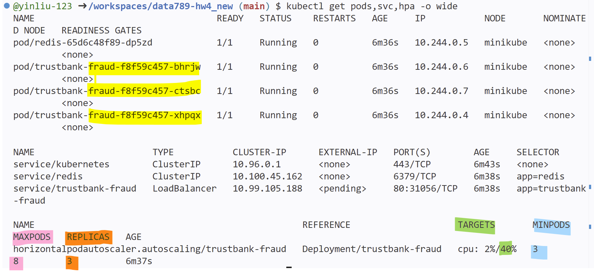

## Verify, predict and self healing
I connected port 8080 on my Codespace to port 80 on the Kubernetes Service
then tested `/predict` and demonstrated recovery after deleting a pod.

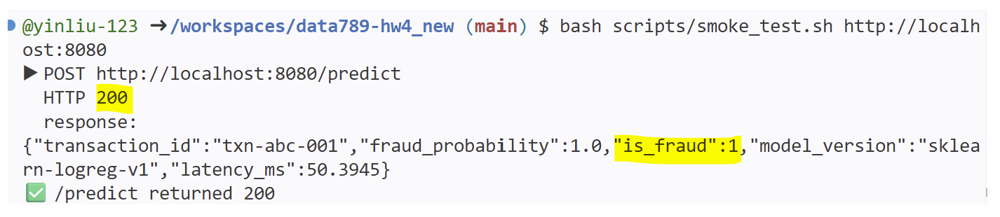
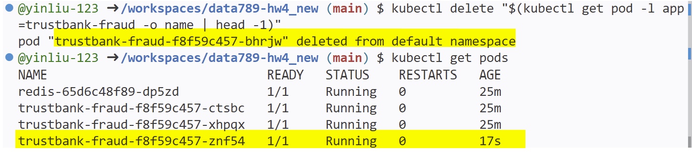

## Application updates

I demonstrated a rolling update from v1 to v2 with zero dropped
requests in the in-cluster test. I also demonstrated a blue-green
cutover to green and a rollback to blue.
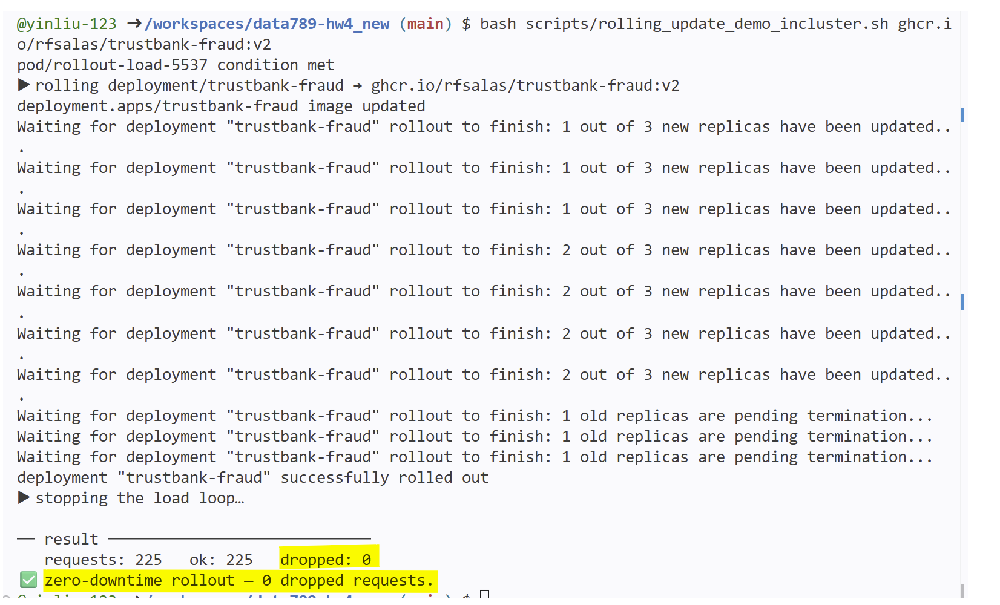
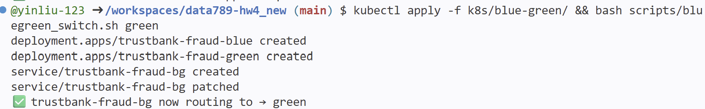
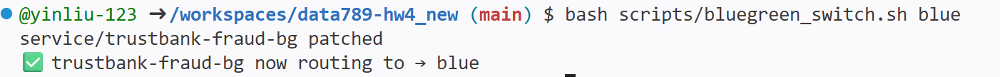

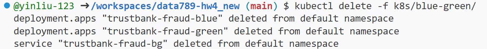
## Azure deployment

I deployed the provided image through Azure Container Registry
to Azure Container Apps and verified the `/health` returned a {"status":"ok"} and that the public `/predict`
endpoint returned HTTP 200 and a prediction.

After capturing evidence, I ran the teardown script and confirmed
that `az group exists -n rg-data789-hw4-yinliu` returned `false`.
The Azure endpoint is no longer live.

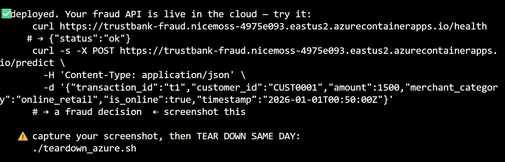
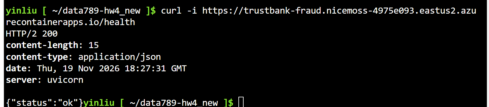
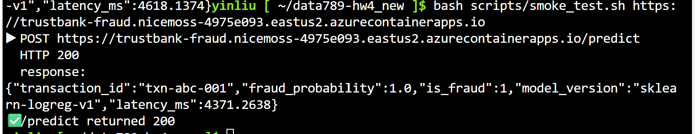
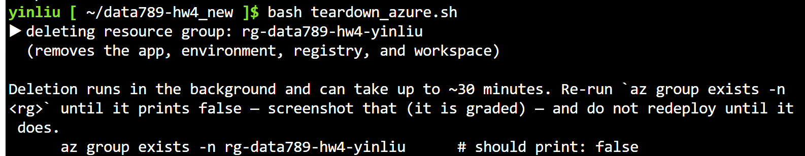

